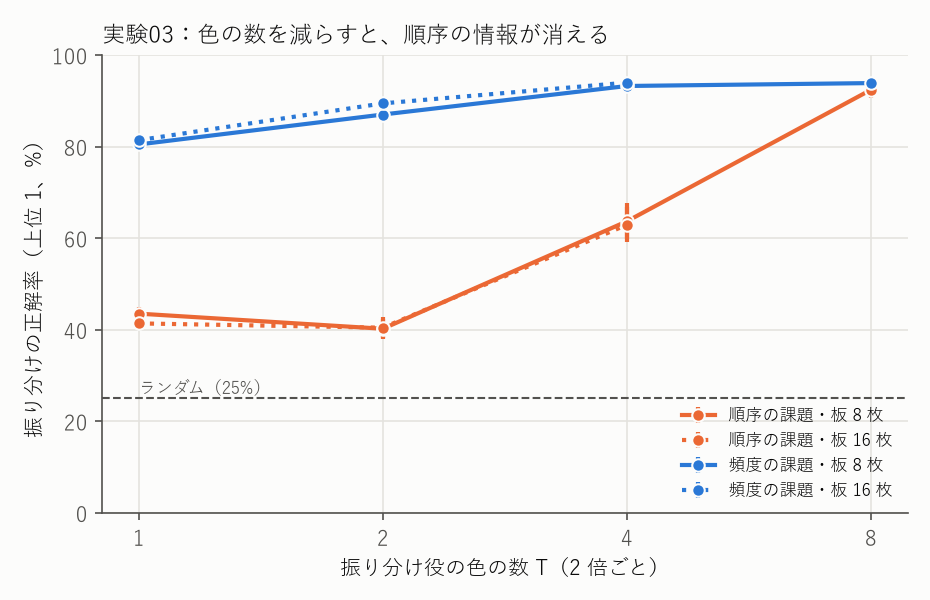
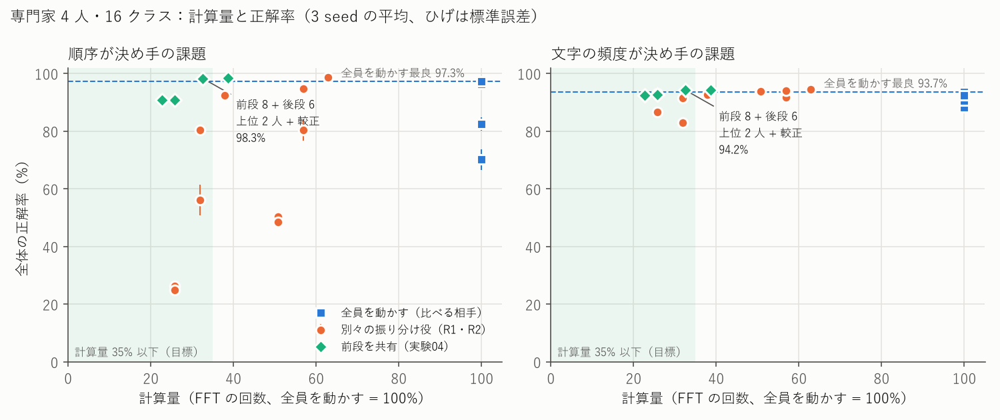
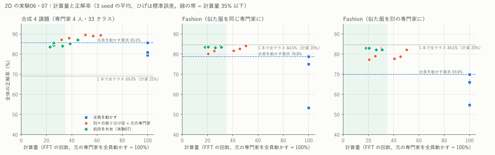
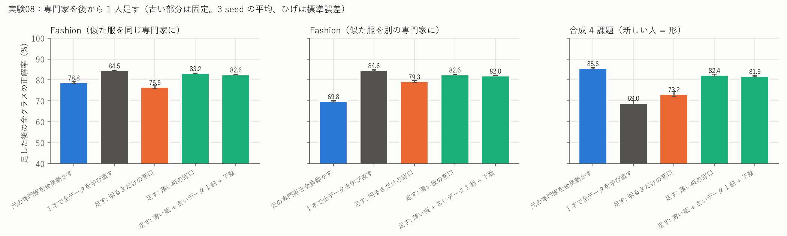

# SN2-Acoustics 実験の歩み — 8 つの実験でたどる「グレインの組み立て」

この資料は、波で学ぶ小さな部品「グレイン」を組み立てる実験を、**番号順に、目的・方法・結果・得られたもの・問題点**の形で並べたものです。
「どうやってここまで進んだのか」「どこに改良の余地があるのか」を、高校数学程度の知識で追えるように書いています。

- グレイン 1 つのしくみ（SinWave）は、[Sin-CNN2 の説明資料](https://github.com/devaf09/Sin-CNN2/blob/main/docs/introduction.md)にあります。
- 数字の元になった記録は [NOTES.md](../NOTES.md)、実験のプログラムは `experiments/`、条件は `experiments/sweeps/sweepNN.sh`（NN = 実験番号）、結果は `results/expNN.txt` にあります。
- うまくいかなかった実験もすべて載せています。「効かなかった」という結果も、次の一手を決める大事な情報だからです。

---

## 目次

1. [この資料を読むための最小限の言葉](#1-この資料を読むための最小限の言葉)
2. [全体の流れ](#2-全体の流れ)
3. [実験の一覧](#3-実験の一覧)
4. [各実験の詳細](#4-各実験の詳細)
5. [まとめ](#5-まとめ)
6. [改良できそうな点（挑戦したい人へ）](#6-改良できそうな点挑戦したい人へ)

---

## 1. この資料を読むための最小限の言葉

| 言葉 | 意味 |
|---|---|
| グレイン | 波で学ぶ学習器 1 つ（SinWave）のこと。音の小さな粒を集めて音を作る「グラニュラー合成」から名付けた。この資料の主役 |
| 専門家 | 決まった仕分け先（クラス）だけを担当するグレイン。たとえば 16 種類のうち 4 種類だけを覚える |
| 振り分け役 | 入力を見て「どの専門家に任せるか」を決めるグレイン（またはそれに相当する仕組み） |
| クラス | 仕分け先の種類 |
| 正解率（テスト） | **学習に使っていない**問題のうち、正しく答えた割合 |
| 振り分けの正解率 | 入力を、正しい専門家に送れた割合 |
| 計算量 | 波の計算（FFT という変換）を何回するか。この資料では「専門家を全員動かした場合 = 100%」として割合で表す |
| 比較相手（比べる相手） | 新しい方法の数字の良し悪しを判断するための、別の方法の数字。この資料では主に「専門家を全員動かす方法」と「でたらめに送る方法（ゼロ点）」 |
| ロジスティック回帰 | 定番の単純な学習器。「どの文字が何回出たか」に重みを掛けて足し、一番大きいものを選ぶ |
| seed（シード） | 乱数の種。同じ条件でも seed が違うと結果が少し揺れる。この資料の数字は、seed を 3 つ変えた平均 |
| 平均±標準誤差 | 3 回の平均と、その平均のぶれの目安。「98.3±0.5」なら、本当の値はおおよそ 97〜99 の間 |
| レンズ（FFT） | 光を「向き」ごとに 1 点に集める道具。計算では FFT という変換にあたる。レンズの後では「文字の種類 = スクリーン上の場所」になる |
| 干渉 | 波が重なって、強め合ったり打ち消し合ったりすること。文字どうしの「並び」の情報は、干渉させないと現れない |
| 較正 | 専門家ごとに点数の目盛りがずれているのを、別に取っておいたデータ（検証用データ）で合わせ直すこと |

---

## 2. 全体の流れ

| 段階 | 実験 | 問い | 一言でいうと |
|---|---|---|---|
| ① 担当だけ動かせるか | 01 | 振り分け役を使えば、全員を動かさずに済むか | 文字の頻度で決まる課題では、計算 1/4 で全員を動かすより良くなった。ただし課題が易しすぎた |
| ② 本当の力を測る | 02 | 文字の並び順で決まる課題でも振り分けられるか | レンズの後の明るさだけでは並び順は分からない。全員を動かす方式にも強いやり方（自信で選ぶ）があった |
| ③ 計算を減らす工夫 | 03, 04 | 振り分け役の計算をどう減らすか | 光の色の数を減らすと並び順が消えた（03）。振り分け役の前半を専門家と共有すると、目標を満たした（04） |
| ④ 後から足す | 05 | 専門家を後から 1 人足せるか、外せるか | 外すのは完全に元どおり。足すのは、頻度の課題ではほぼうまくいき、並び順の課題では振り分けが弱かった |
| ⑤ 絵（2 次元）で | 06, 07 | 同じ組み立てが、絵を見るグレインでも成り立つか | 作った絵の課題では成り立った。本物の服の写真（Fashion-MNIST）では、専門家に分けるより 1 本で全部を覚える方が良かった |

研究の進み方の特徴は、**比べる相手を強くすると結論が変わる**ことです。
実験01 では「振り分け役が勝った」と思いましたが、実験02 で全員を動かす方式のもっと良いやり方が見つかり、勝ち負けが逆転しました。そこから実験04 の工夫が生まれています。

---

## 3. 実験の一覧

判定: ◎ 大きな成果 / ○ 効いた / △ 一部・確認 / × 効かなかった

| 番号 | 名前 | 判定 | 一言の結果 |
|---|---|---|---|
| 01 | 担当だけを動かす振り分け役 | ○ | 頻度の課題で、全員を動かして足す方式（88.2%）より良い 93.2% を、計算 25.8% で |
| 02 | 並び順で決まる課題と較正 | △ | 明るさだけの振り分け役は偶然と同じ 26.3%。較正で上位 2 人が生きる。比べる相手が 97.3% に上がる |
| 03 | 振り分け役の色を減らす | × | 色を減らすと並び順の情報が消え、振り分けが 92% → 64% → 40% に |
| 04 | 前半の板を共有する | ◎ | 並び順の課題 98.3%（相手 97.3%）、頻度の課題 94.2%（相手 93.7%）を計算 32.6% で |
| 05 | 専門家を後から足す | △ | 外すと完全に元どおり。足すと頻度の課題はほぼ並ぶが、並び順の課題は 91.0%（相手 96.1%） |
| 06 | 絵のグレインで振り分け | △ | 作った絵: 振り分けで全員を動かすより良く（87.1% 対 85.6%）計算 1/3。服の写真: 1 本で全クラス（84.5%）に負けた |
| 07 | 絵のグレインで前半を共有 | △ | 服の写真: 別々の振り分け役と同じ正解率を計算 18% で。作った絵: 少し落ちた |
| 08 | 絵のグレインで専門家を後から足す | ○ | 服の写真: 古い部分を学び直さずに足して、全部学び直した 1 本に 1〜2 点差（計算 1/5）。外すと完全に元どおり |

---

## 4. 各実験の詳細

#### 実験01「担当だけを動かす振り分け役」○

- **目的**: これまで（Sin-CNN2）は、得意分野の違うグレインを合わせるとき、全員を動かして答えを足していました。これだと専門家が増えるほど計算が増えます。入力ごとに担当の専門家だけを動かせば、計算を減らせるはずです。
- **方法**: 16 種類の文字列を仕分ける課題（クラスごとに出やすい文字が決まっている「頻度の課題」）を作り、専門家 4 人が 4 種類ずつ担当しました。振り分け役として、
  - **水面の板（R1）**: 入力の光をレンズに通し、スクリーンの明るさの模様に、専門家ごとの「すかし模様」を重ねて、一番明るく透けた専門家を選ぶ
  - **薄い SinWave（R2）**: 板 2〜4 枚の小さなグレイン
  を試し、選んだ専門家だけを動かしました。
- **結果**（専門家 4 人・16 クラス）:

  | 方式 | 正解率 | 計算量 |
  |---|---|---|
  | でたらめに送る（ゼロ点） | 23.9% | 25% |
  | 全員を動かして足す | 88.2% | 100% |
  | 全員を動かして gate（光の割合で選ぶ） | 90.5% | 100% |
  | **水面の板（R1）で 1 人に送る** | **93.2%** | **25.8%** |
  | 薄い SinWave（板 4 枚）で 1 人に送る | 83.1% | 31.8% |
  | 参考: 文字の数を数える単純な方法で直接仕分け | 95.1% | - |

- **得られたもの**: 振り分け役を使うと、全員を動かして足すより正しく、しかも計算は約 1/4 で済みました。専門家 1 人の学習は、GPU で約 90 秒、CPU では約 13 分です。
- **問題点**: この課題は「どの文字が何回出たか」だけで解けてしまい、単純な方法（95.1%）の方が上でした。水面の板は、実はその単純な方法と同じことをしていました。本当の力を測るには、文字の並び順で決まる課題が必要です。

#### 実験02「並び順で決まる課題と較正」△

- **目的**: 実験01 の課題が易しすぎたので、**文字の種類と回数はどのクラスでも同じで、隣り合う 2 文字の順番（「あい」か「いあ」か）だけでクラスが決まる課題**を作って測り直しました。また、上位 2 人を動かしても正解率がほとんど上がらない問題も調べました。
- **方法**: 実験01 の方式に加えて、
  - 全員を動かし、**いちばん自信のある専門家の答えを採る**方式
  - 専門家ごとの点数の目盛りを、検証用データで**較正**してから比べる方式
  - 振り分け役の薄い SinWave を少し強くしたもの（板 8 枚・区画 64）
  を比べました。
- **結果**（並び順の課題、専門家 4 人・16 クラス）:

  | 方式 | 正解率 | 計算量 |
  |---|---|---|
  | でたらめに送る（ゼロ点） | 24.5% | 25% |
  | 全員を動かして足す | 70.2% | 100% |
  | **全員を動かして、自信で選ぶ** | **97.3%** | 100% |
  | 水面の板（R1）で 1 人に送る | 26.3% | 25.8% |
  | 薄い SinWave（板 8 枚）で 1 人に送る | 92.4% | 37.9% |
  | 同じ振り分け役で 2 人に送り、較正 | 98.7% | 62.9% |
  | 参考: 文字の数を数える単純な方法 | 6.7%（偶然と同じ） | - |

- **得られたもの**:
  - レンズの後の明るさは「どの文字が何回出たか」しか表さず、**文字の並び順は原理的に分からない**ことがはっきりしました。並び順を見るには、板を通して文字どうしを干渉させる必要があります。
  - 専門家の点数には「これは自分の担当ではない」という情報がちゃんと入っていて、較正して比べると、上位 2 人を動かす方式が大きく伸びました（83.8% → 94.8%）。
- **問題点**: 全員を動かして自信で選ぶ方式が 97.3% と強く、計算量 35% 以下で、これに並ぶ方法がまだありません。途中で、較正の作り方を間違えていたことにも気づきました（直して計算し直し、間違った版の結果も残しています）。

#### 実験03「振り分け役の色を減らす」×

- **目的**: 実験02 の薄い SinWave（板 8 枚）は、計算量 37.9% で目標（35%）を少し超えていました。振り分け役だけ、光の「色の数」を減らせば計算が減ります。
- **方法**: SinWave では、文字の位置ごとに色を少しずつずらした光（虹）を、8 色ぶん計算しています。振り分け役だけ、この色の数を 8 → 4 → 2 → 1 に減らしました。
- **結果**（並び順の課題、振り分けの正解率）:

  | 色の数 | 板 8 枚 | 板 16 枚 | 計算量（板 8 枚） |
  |---|---|---|---|
  | 8 | 92.4% | - | 37.9% |
  | 4 | 63.7% | 62.9% | 31.4% |
  | 2 | 40.2% | 40.5% | 28.2% |
  | 1 | 43.5% | 41.4% | 26.6% |

  

- **得られたもの**: 色を何色も重ねて平均することで、離れた文字どうしの干渉が打ち消され、「隣どうし」の関係だけが残っていたことが分かりました。色を減らすと全部の文字が干渉し合い、並び順の手がかりが埋もれます。板を増やしても取り戻せません。
- **問題点**: 計算を減らすには、色の数ではなく、別の方向（計算の使い回し）が必要です。

#### 実験04「前半の板を共有する」◎

- **目的**: 振り分け役の計算は、答えを出すのには使われず、「無駄」になっていました。これを専門家の計算の一部として使い回せないか。
- **方法**: たとえるなら、全員共通の「入口の部屋」を作るやり方です。
  1. 振り分け役（板 8 枚のグレイン）を学習して、その板を固定し、**全専門家に共通の前半（前段）**にする
  2. 前段を出た光をレンズで見て、上位 2 人の専門家を選ぶ
  3. 同じ光を、選んだ専門家の**後半（後段、板 6 枚）**にだけ通す
  4. 2 人の答えを、較正した点数で比べる
- **結果**（専門家 4 人・16 クラス）:

  | 方式 | 並び順の課題 | 頻度の課題 | 計算量 | 学習する数 |
  |---|---|---|---|---|
  | 全員を動かす（一番良いやり方） | 97.3% | 93.7% | 100% | 8260 |
  | **前段を共有、後段 6 枚、2 人に送って較正** | **98.3%** | **94.2%** | **32.6%** | **4169** |
  | 前段を共有、後段 6 枚、1 人に送る | 90.8% | 92.5% | 22.7% | 4169 |

  

- **得られたもの**: 振り分けのために学習した板が、そのまま専門家の前半として使えました。両方の課題で、全員を動かす一番良いやり方と同じ以上の正解率を、約 1/3 の計算・半分の学習する数で出せました。
- **問題点**: 振り分けそのものの正解率は 91〜94% で、目標の 95% に届いていません（2 人目と較正で救っている）。頻度の課題での差（94.2 対 93.7）は小さく、seed を増やすと逆転するかもしれません。

#### 実験05「専門家を後から足す」△

- **目的**: 実験04 の前段は、最初の 4 人のために作られた「共通の言葉」です。あとから 5 人目（新しい 4 クラス）を足せるか、外したら元に戻るかを確かめました。
- **方法**: 前段と、振り分けの既存の出口はそのまま固定し、
  - 5 人目の後段（新しいデータだけで学習）
  - 振り分けの 5 つ目の出口（「5 人目かどうか」を判断。古いデータも少し混ぜて学習）
  だけを足しました。
- **結果**（5 人・20 クラス）:

  | 方式 | 並び順の課題 | 頻度の課題 | 計算量 |
  |---|---|---|---|
  | 元の専門家 5 人を全員動かす（一番良いやり方） | 96.1% | 93.0% | 100% |
  | 後から足した系（2 人に送って較正） | 91.0% | 92.6% | 26.1% |
  | 5 人目を外す | 足す前と 1 件残らず同じ答え | 同じ | - |

- **得られたもの**: 外すのは完全に元どおりになりました。5 人目の後段は、前段を変えなくてもちゃんと学べました（並び順の課題で 100%）。頻度の課題では、全員を動かすやり方とほぼ並びました。
- **問題点**: 並び順の課題では、5 つ目の出口が新しい並びを見分けられません（新しい入力のうち正しく送れるのは 32〜84%）。出口がレンズの後の明るさしか見ていないためと考えられます。混ぜる古いデータの量で、出口が弱すぎたり強すぎたりもします。

#### 実験06「絵のグレインで振り分け」△

- **目的**: これまでの実験は文字列でした。2 次元の絵を見るグレイン（SN2-Parts-2D で作られた部品）でも、「担当の専門家だけを動かして計算を減らす」ことができるかを確かめました。
- **方法**: 2 つの課題で試しました。
  - **作った絵**: 縞の向き・物の位置・向きと位置の組み合わせ・形、の 4 つの課題を、専門家 4 人が 1 つずつ担当（全部で 33 種類）
  - **服の写真（Fashion-MNIST）**: 10 種類の服を、専門家 5 人が 2 種類ずつ担当。「似た服（T シャツとシャツなど）を同じ専門家に」と「別の専門家に」の 2 通り
  専門家は、自分の担当の絵と「どれでもない」ぼやけた絵で学習します。比べたのは、全員を動かす 3 つのやり方、振り分け役で 1〜2 人だけ動かすやり方、そして**専門家に分けずに 1 本で全部を覚えるグレイン**です。
- **結果**:

  | 方式 | 作った絵 | 服（似た服を同じ専門家に） | 服（似た服を別の専門家に） | 計算量 |
  |---|---|---|---|---|
  | でたらめに送る | 22.6% | 18.6% | 20.1% | 20〜25% |
  | 全員を動かす（一番良いやり方） | 85.6% | 78.8% | 69.8% | 100% |
  | **振り分け役で 1 人だけ動かす** | **87.1%** | 84.1% | 82.9% | 30〜38% |
  | 1 本で全部を覚える | 69.0% | **84.5%** | **84.6%** | 20〜25% |

  

- **得られたもの**: 作った絵では、振り分けが全員を動かすより正しく、計算は約 1/3（振り分けの正解率 95.2%）。文字列で決めた 3 つの目標を、絵でも満たしました。
- **問題点**: 服の写真では、**専門家に分けるより、1 本で全部を覚える方が良い**という結果でした。全員を動かすと、専門家が「自分の担当ではない服」にも自信を持って答えてしまいます（ぼやけた絵で「どれでもない」を教えても、本物の服には効きませんでした）。

#### 実験07「絵のグレインで前半を共有」△

- **目的**: 文字列でいちばん効いた「振り分け役の前半を、全専門家の共通の前半にする」（実験04）が、絵でも効くかを確かめました。
- **方法**: 振り分け役（板 8 枚）を固定して共通の前半にし、専門家は後半の板 6〜8 枚だけを持ちます。
- **結果**:

  | 方式 | 作った絵 | 服（同じ） | 服（別） | 計算量 |
  |---|---|---|---|---|
  | 別々の振り分け役 + 元の専門家（実験06） | 88.0% | 84.1% | 82.9% | 30〜38% |
  | **前半を共有、1 人だけ動かす** | 83.5% | **83.4%** | **82.9%** | **18〜23%** |
  | 1 本で全部を覚える（実験06） | 69.0% | 84.5% | 84.6% | 20〜25% |

- **得られたもの**: 服の写真では、別々の振り分け役と同じ正解率を、もっと少ない計算（18%）と少ない学習する数（約 4 割）で出せました。
- **問題点**: 作った絵では少し落ちました（後半が薄いと、形の課題などが弱くなる）。服の写真では、やはり 1 本で全部を覚える方がわずかに上です。専門家に分ける利点は「正解率」ではなく「後から足す・外す」にあるはずなので、それを次の実験08 で確かめます。

#### 実験08「絵のグレインで専門家を後から足す」○

- **目的**: 実験06・07 で、服の写真では「専門家に分けず 1 本で全部を覚える」方が少し正しいと分かりました。専門家に分ける本当の利点は、**あとから専門家を足したり外したりできること**のはずです（1 本だと、新しい種類を覚えるには全部のデータで学び直し）。それを確かめました。
- **方法**: 最後の専門家を「あとから来た人」にします。それまでの仕組み（共通の前半・古い専門家・受付の窓口）は固定して触らず、新しい専門家の後半と、新しい受付の窓口だけを学習します。窓口は 2 種類を比べました: 明るさの模様を見るだけの窓口（文字列の実験05 と同じ）と、**薄い板を 2 枚つけた窓口**。窓口の学習に混ぜる古いデータの量（全部 / 1 割）と、学習の後に窓口の「起こりやすさ（下駄）」を合わせ直すかどうかも変えました。
- **結果**（服の写真、全クラスの正解率）:

  | 方式 | 似た服を同じ専門家に | 似た服を別の専門家に | 計算量 |
  |---|---|---|---|
  | 元の専門家を全員動かす | 78.8% | 69.8% | 100% |
  | 1 本で全データを最初から学び直す | 84.5% | 84.6% | 20% |
  | 足す: 明るさだけの窓口 | 76.6% | 79.3% | 18% |
  | **足す: 薄い板の窓口** | **83.2%** | **82.6%** | 21% |
  | 足す: 薄い板 + 古いデータ 1 割 + 下駄の合わせ直し | 82.6% | 82.0% | 21% |

  

- **得られたもの**: 古い部分を一切学び直さずに、全部を学び直した 1 本に 1〜2 点差まで迫りました。新しい専門家を外すと、古い答えが 1 件残らず元に戻ります。薄い板の窓口は、新しい人を正しく受け付ける割合を 70% 前後から 85〜91% に上げました。下駄を合わせ直せば、混ぜる古いデータは 1 割で足ります。
- **問題点**: 足すと古いクラスが 2〜3 点下がります。作った絵では、新しい人（形の課題）を後半 6 枚では覚えきれず、全員を動かす方式に負けました。比べた「1 本で学び直す」は全データを使うので、足す側に厳しい比べ方です。

---

## 5. まとめ

**効いたもの（大きい順）**
0. 専門家を後から足すときの「薄い板の窓口」と下駄の合わせ直し（絵、実験08）
1. 振り分け役の前半を、全専門家の共通の前段にする（実験04）
2. 専門家の点数を較正して比べる（上位 2 人が生きる、実験02）
3. 全員を動かすなら、足すのではなく「自信で選ぶ」（実験02）
4. 担当だけを動かす振り分け役そのもの（頻度の課題、実験01）

**効かなかったもの**
- レンズの後の明るさだけで振り分ける（並び順の課題、実験02）
- 振り分け役の色の数を減らす（実験03）
- 後から足す専門家の出口を、明るさだけで作る（並び順の課題、実験05）

**まだ解けていないこと**
- 本物の写真（服）では、専門家に分けるより 1 本で全部を覚える方が良い（実験06・07）。分ける利点を「後から足す・外す」で示すこと（実験08）
- 振り分けそのものの正解率 95%
- 並び順の課題で、専門家を後から足すこと
- 文字列の本物のデータ（文章）での確認

---

## 6. 改良できそうな点（挑戦したい人へ）

- **前段を厚くする・一緒に少し学び直す**: 前段を 10 枚にする、前段と後段を最後に少しだけ一緒に学習する。振り分けの 95% を狙う。
- **新しい出口に薄い板を足す**: 後から足す専門家の出口を、明るさの模様ではなく、前段の後ろに薄い板 2〜4 枚を足した形にする。並び順も見られるはず。
- **新しい出口の「下駄」を合わせる**: 混ぜる古いデータの量の影響を、検証用データで打ち消す。
- **将来の専門家のための前段**: 最初から「振り分け」だけでなく「全クラスの仕分け」も同時に学ばせて、前段を何にでも使える共通の言葉にする。
- **2 次元の部品で同じことを**: 画像用のグレインができたら、同じ組み立て（振り分け・共有・追加・取消）を試す。
